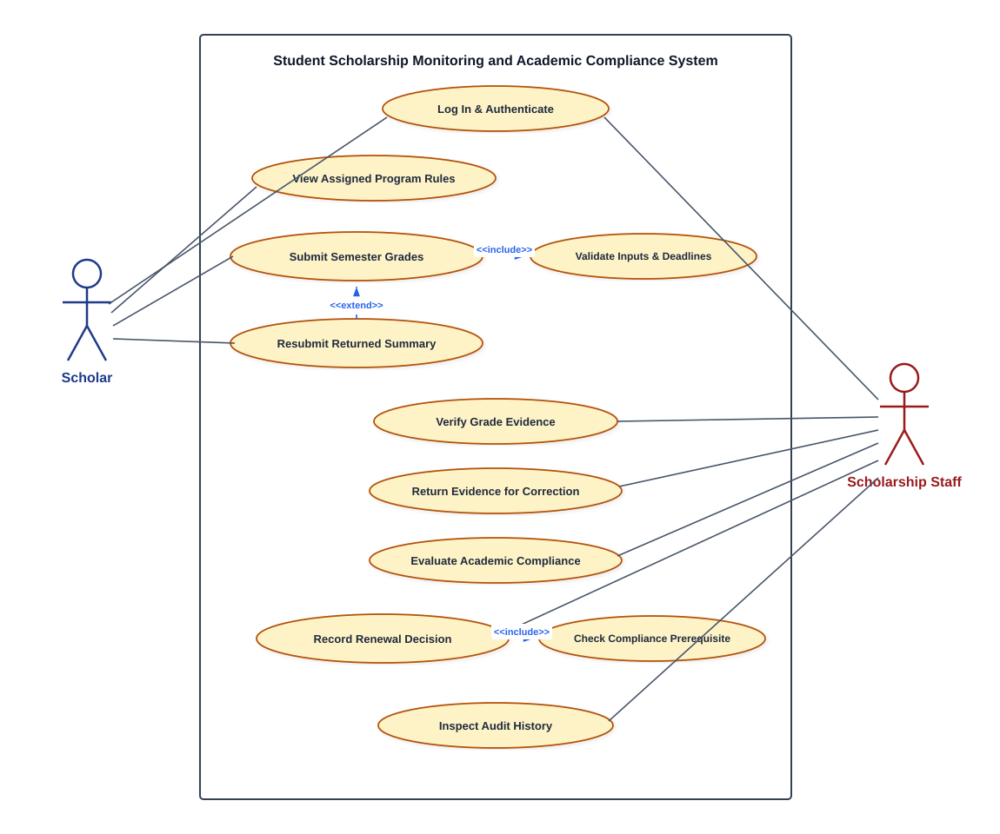
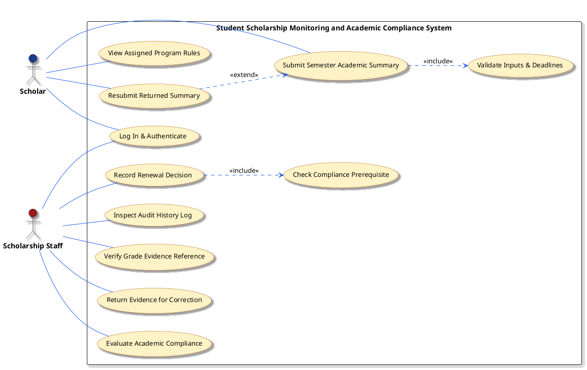
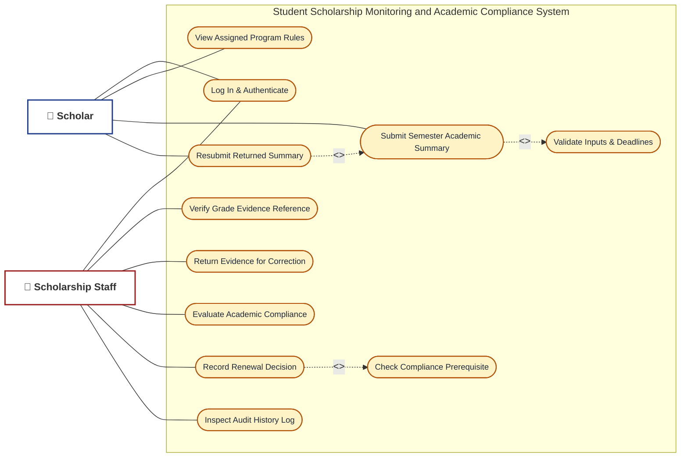
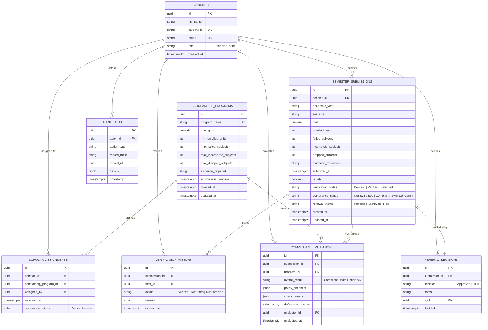

# SYSTEMS ANALYSIS AND DESIGN (SAD) DOCUMENTATION
## Student Scholarship Monitoring and Academic Compliance System (SSMAS)
### ITPC111 – Systems Analysis and Design Midterm Laboratory Examination
**Academic Year**: 2026–2027 &bull; **Timezone Standard**: Asia/Manila (UTC+08:00)

---

# SECTION A1. INVESTIGATION AND PLANNING

## 1.1 Problem Statement
The Scholarship Office historically administered the *Merit Scholar* and *Community Scholar* programs using distributed spreadsheets and physical paper receipts. This spreadsheet-reliant approach created acute operational vulnerabilities: scholars submitted unverified grade claims without standardized documentary validation; scholarship staff manually performed error-prone threshold comparisons across disparate sheets; submission timestamps could not reliably prove adherence to strict application deadlines; and scholars lacked visibility into why their renewals were held or delayed. The absence of an immutable audit trail and unified relational database led to data fragmentation, unauthorized modifications, duplicate entries, and delayed renewal disbursements. 

The **Student Scholarship Monitoring and Academic Compliance System (SSMAS)** replaces this fragmented workflow with a centralized, browser-based, database-driven platform featuring role-based access control, cryptographic session authentication, automated compliance evaluation engines, explicit multi-stage renewal workflows, and immutable audit logs.

## 1.2 Four Problem-Cause-Effect Entries

| Entry # | Problem Observed | Root Cause | Organizational & Operational Effect |
|:---:|:---|:---|:---|
| **PCE-01** | Inconsistent scholarship renewal eligibility determinations. | Staff manually referenced physical policy handouts and unlinked spreadsheets, leading to human calculation error. | Ineligible scholars with deficient grades or dropped courses were erroneously approved, while compliant scholars experienced renewal delays. |
| **PCE-02** | Fraudulent or inaccurate grade submissions. | Lack of mandatory evidence linkage and pre-evaluation verification gates; students entered self-reported GPAs without immediate documentary accountability. | Scholarship funds risked wrongful disbursement; staff spent excessive hours auditing physical grade sheets post-renewal. |
| **PCE-03** | Disputes over submission deadlines. | Absence of a synchronized, server-side Manila timezone timestamp; reliance on client-reported local computer clocks or email receipt timestamps. | Administrative friction and contentious appeals regarding whether submissions arrived before the October 30 deadline. |
| **PCE-04** | Data loss and duplicate record conflicts. | Concurrent spreadsheet file editing without database-level row locking, foreign key constraints, or unique academic period constraints. | Overwritten records, duplicate semester entries for identical scholars, lost deficiency notes, and zero audit history of who approved renewals. |

## 1.3 Project Scope and Exclusions

### Within Scope (System Boundaries)
1. **Cryptographic Authentication & Role-Based Authorization**: Supabase Auth and PostgreSQL Row Level Security (RLS) enforcing complete data isolation between Scholars and Scholarship Staff.
2. **Program Threshold Administration**: Database persistence of academic criteria (Max GWA, Min Units, Max Failed, Max Incomplete, Max Dropped, Manila Deadlines) for Merit and Community Scholar programs.
3. **Academic Summary Submission**: Student portal for entering AY, Semester, GWA, unit loads, deficiency counts, and supporting grade-document references with client-side and server-side validation.
4. **Documentary Evidence Verification Queue**: Staff interface to examine grade references, verify documents, or return submissions with mandatory corrective feedback.
5. **Automated Compliance Engine**: Server/database execution of 7-point policy checks strictly blocked until evidence is verified, generating itemized deficiency reports.
6. **Explicit Renewal Decision Station**: Staff approval and hold workflows requiring justification notes and enforcing compliance preconditions.
7. **Comprehensive Audit History**: Immutable chronological tracking of all administrative actions, resubmissions, and timestamped state transitions.

### Explicit Project Exclusions (Out of Scope)
1. **Registrar Grade Modification**: The system does NOT alter or serve as the official record of the University Registrar. Official grades originate solely from the Registrar.
2. **Financial Disbursement / Banking Gateway**: The system does NOT disburse monetary stipends, link to banking APIs, or issue checks.
3. **Automated Renewal Overrides**: The system does NOT automatically approve or disqualify scholars based solely on algorithm flags; staff review remains mandatory.

## 1.4 Four Core Development Tasks
1. **Task T1 – Relational Database Architecture & Constraint Design**: Formulate normalized schema (`profiles`, `scholarship_programs`, `scholar_assignments`, `semester_submissions`, `verification_history`, `compliance_evaluations`, `renewal_decisions`, `audit_logs`), stored procedures, RLS policies, and indexes.
2. **Task T2 – Dual-Mode Authentication & Security Layer**: Implement Supabase Auth integrated with local database fallback simulation guaranteeing role-based route protection and offline test reliability.
3. **Task T3 – Verification & Compliance Evaluation Engine**: Build the 7-rule evaluation algorithm reading persisted program thresholds, implementing the verification precondition gate, and generating specific deficiency rationales.
4. **Task T4 – Administrative Dashboard & Functional Test Automation**: Implement responsive CSS/HTML UI, metrics aggregation, multi-criteria filtering, and the interactive TC01–TC10 test runner.

## 1.5 Two Project Risks and Mitigation Responses
- **Risk R1: Network Disruption or Supabase Outage During Midterm Examination / Defense**:
  - *Response*: Implemented a dual-mode data layer (`supabase-client.js`). If Supabase credentials are not provided or remote internet drops, the system seamlessly activates the local database simulation engine with identical table schemas, unique constraints, and seed data, ensuring uninterrupted evaluation.
- **Risk R2: Client-Side Clock Tampering to Evade Submission Deadlines**:
  - *Response*: Application deadline evaluation relies on server-enforced ISO Manila timestamps (`Asia/Manila` UTC+08:00) generated at the database level rather than trusting browser clocks.

---

# SECTION A2. STAKEHOLDERS AND ELICITATION

## 2.1 Four System Stakeholders
1. **Scholar (Primary System Actor)**: Current collegiate scholarship recipient who enters semester academic summaries, attaches official document references, and resubmits corrected records if returned.
2. **Scholarship Staff (Primary System Actor)**: University administrator who inspects grade evidence, marks documents as Verified or Returned, triggers compliance evaluations, and issues renewal decisions.
3. **Scholarship Committee / University Dean (Governance Stakeholder)**: High-level academic authorities who review compliance statistics, deficiency summaries, and renewal audit trails for policy planning.
4. **University Registrar (External Institutional Stakeholder)**: Official academic records custodian whose official transcripts serve as the external ground truth for student-provided document references.

## 2.2 System Actors vs. Non-Actors
- **System Actors (Direct Interaction)**:
  - *Scholar*: Interacts directly with the web interface to submit grades, view compliance outcomes, and execute resubmissions.
  - *Scholarship Staff*: Interacts directly with administrative dashboards, verification queues, evaluation modules, and renewal decision screens.
- **Non-Actors (Indirect Stakeholders)**:
  - *University Registrar*: Does not directly log into or operate this system; their role is external verification proof.
  - *Scholarship Committee / External Donors*: Non-actors who consume exported audit reports and high-level dashboard summaries without direct operational CRUD access.

## 2.3 Six Open-Ended Requirements Elicitation Questions

1. **Document Verification**: *"What specific security marks, registrar seals, or cryptographic hashes must Scholarship Staff verify on a submitted grade slip before evidence can be certified as Verified?"*
2. **Deadline Management**: *"Under what institutional circumstances (e.g., typhoon suspensions, registrar server downtime) may a submission received after 5:00 PM Manila time on October 30 be granted an official policy waiver?"*
3. **Policy Exceptions**: *"How should the compliance engine handle a scholar who meets the cumulative GWA requirement but dropped a prerequisite subject due to documented medical emergencies?"*
4. **Access Control & Privacy**: *"What restrictions must be placed on student demographic and academic deficiency data to comply with national data privacy legislation when multiple staff members access the queue?"*
5. **Auditing & Accountability**: *"What exact metadata (e.g., IP address, user UUID, before-and-after state snapshots) must be preserved when a staff member overrides an initial return decision?"*
6. **Reporting Requirements**: *"What specific comparative metrics (e.g., deficiency rate by academic department, percentage of late submissions) are required by university trustees at the close of each semester?"*

---

# SECTION A3. REQUIREMENTS AND BUSINESS RULES

## 3.1 Ten Testable Functional Requirements (FR01–FR10)

- **FR01 – Scholar Profile & Program Assignment**: The system shall retrieve and display the authenticated scholar's active scholarship program (Merit Scholar or Community Scholar) and its specific policy thresholds upon dashboard load.
- **FR02 – Semester Grade Submission**: The system shall permit authenticated scholars to input Academic Year, Semester, GWA, Enrolled Units, Failed Subjects, Incomplete Grades, Dropped Subjects, and a Supporting Document Reference.
- **FR03 – Input Validation & Duplicate Rejection**: The system shall validate that GWA is between 1.00 and 5.00, units and counts are non-negative integers, and strictly reject duplicate submissions matching the same `(scholar_id, academic_year, semester)`.
- **FR04 – Manila Timezone Deadline Verification**: The system shall evaluate submission arrival against the official Manila deadline (`2026-10-30T17:00:00+08:00`), setting `is_late = TRUE` strictly when submitted after 5:00:00 PM PHT.
- **FR05 – Evidence Verification Workflow**: The system shall allow authorized Staff to mark a submission's evidence as `Verified` or `Returned`. If `Returned`, the system shall require a non-empty explanation of at least 5 characters.
- **FR06 – Correction and Resubmission**: The system shall allow a scholar whose submission is in `Returned` status to modify their reported metrics and document reference, resetting `verification_status` to `Pending` while preserving history.
- **FR07 – Precondition Verification Gate**: The system shall strictly block compliance evaluation and renewal approval if a submission's `verification_status` is not `Verified`.
- **FR08 – 7-Point Compliance Evaluation**: The system shall evaluate verified submissions against the persisted program thresholds for GWA, Units, Failed, Incomplete, Dropped, Evidence, and Deadline, outputting itemized check results and specific deficiency reasons.
- **FR09 – Explicit Staff Renewal Decisions**: The system shall enable staff to record an `Approved` or `Held` renewal decision. Approval shall be strictly forbidden unless evidence is `Verified` and compliance is `Compliant`. A `Held` decision shall require explanatory notes.
- **FR10 – System-Wide Audit History**: The system shall record all inserts, verification transitions, compliance evaluations, and renewal decisions in an immutable `audit_logs` table accessible only to staff.

## 3.2 Four Measurable Non-Functional Requirements (NFR01–NFR04)

- **NFR01 – Performance**: System dashboard metrics and filtered queries over at least 5,000 synthetic records shall render in less than 500 milliseconds on standard desktop and mobile browsers.
- **NFR02 – Security & Data Isolation**: Row Level Security (RLS) policies shall guarantee that 100% of unauthorized direct REST or SQL queries from a Scholar account attempting to read another scholar's records or modify review statuses receive an HTTP 403 / PostgreSQL permission denied error.
- **NFR03 – Reliability & Offline Fallback**: The client-side database simulation engine shall maintain 100% functional test equivalence with live Supabase PostgreSQL, executing TC01–TC10 with zero network access.
- **NFR04 – Usability & Accessibility**: All form inputs shall possess semantic `<label>` associations, maintain contrast ratios of at least 4.5:1 conforming to WCAG 2.1 AA standards, and provide mobile-responsive viewport scaling.

## 3.3 Six Core Business Rules (BR01–BR06)

- **BR01 – GWA Scale & Program Ceilings**: A lower GWA indicates superior academic achievement. Valid GWA values range from 1.00 to 5.00 inclusive. Merit Scholars must maintain a GWA $\le 1.75$; Community Scholars must maintain a GWA $\le 2.25$.
- **BR02 – Minimum Enrolled Unit Loads**: Merit Scholars must enroll in a minimum of 18 academic units. Community Scholars must enroll in a minimum of 15 academic units.
- **BR03 – Academic Deficiencies & Subject Allowances**: 
  - Merit Scholar: Exactly 0 failed subjects, 0 incomplete grades, and 0 dropped subjects permitted.
  - Community Scholar: Exactly 0 failed subjects, 0 incomplete grades, and a maximum of 1 dropped subject permitted.
- **BR04 – Strict Manila Deadline Enforcement**: Submissions timestamped on or before October 30, 2026 at 5:00:00 PM Manila time (`2026-10-30T17:00:00+08:00`) are on-time. Any submission timestamped at or after 5:00:01 PM is flagged late, resulting in a compliance deficiency.
- **BR05 – Documentary Precondition Gate**: Academic compliance evaluation cannot be executed, and scholarship renewal cannot be approved, unless the supporting grade-document reference has been explicitly certified as `Verified` by Scholarship Staff.
- **BR06 – Renewal Approval Criteria**: Scholarship renewal approval strictly requires:
  1. `verification_status == 'Verified'`
  2. `compliance_status == 'Compliant'`
  A submission evaluated as `With Deficiency`, or remaining in `Pending`/`Returned` verification, cannot be approved. Any decision to place a renewal on `Held` status strictly requires recorded explanatory staff notes.

---

# SECTION A4. UML USE CASE DIAGRAM

## 4.1 Visual UML Use Case Model

---

## 4.2 PlantUML Source Code

---

## 4.3 Mermaid Source Code

---

## 4.4 Architectural Justification of Actors and Relationships

1. **System Boundary**:
   - The rectangle encompasses all eleven automated processes of the **Student Scholarship Monitoring and Academic Compliance System (SSMAS)**.
   - External entities interacting across the boundary are restricted to authenticated **Scholars** and authorized **Scholarship Staff**.

2. **Actors & Associations**:
   - **Scholar (Left Primary Actor)**: Initiates interactions to access assigned rules, file semester grades, and resubmit returned summaries. Connected via solid, undirected association lines.
   - **Scholarship Staff (Right Primary Actor)**: Oversees documentary verification, compliance evaluation, renewal decisions, and audit trail examination. Connected via solid, undirected association lines.
   - **Common Use Case (Log In & Authenticate)**: Associated with both Scholar and Staff actors as the common entry gate.

3. **Justification of `<<include>>` Relationships (Dashed line pointing from Base to Included)**:
   - **`Submit Semester Academic Summary` $\xrightarrow{<<include>>}$ `Validate Inputs & Deadlines`**: Every grade submission mandatory includes automated range checking (GWA 1.00–5.00, non-negative unit/subject integers) and Manila timezone deadline verification (`2026-10-30T17:00:00+08:00`). Grade submission cannot successfully execute without this validation.
   - **`Record Renewal Decision` $\xrightarrow{<<include>>}$ `Check Compliance Prerequisite`**: Staff cannot issue an approval renewal decision without the system executing an automated verification check ensuring evidence is `Verified` and the compliance result is `Compliant`.

4. **Justification of `<<extend>>` Relationship (Dashed line pointing from Extending to Base)**:
   - **`Resubmit Returned Summary` $\xrightarrow{<<extend>>}$ `Submit Semester Academic Summary`**: Resubmission is an optional extension flow triggered only under specific exceptional circumstances—specifically, when a prior submission was marked as `Returned` by staff with corrective feedback. Standard semester submissions execute without invoking this extension.

---

# SECTION A5. DETAILED USE CASES AND ENTITY-RELATIONSHIP DIAGRAM

## 5.1 Detailed Use Case: Submit Grades

- **Use Case ID**: UC-01
- **Use Case Title**: Submit Semester Academic Summary
- **Primary Actor**: Scholar
- **Trigger**: Scholar accesses the "Submit Grades" page from their dashboard.
- **Preconditions**:
  1. Scholar is successfully authenticated with role `'scholar'`.
  2. Scholar has an active assignment to a scholarship program in `scholar_assignments`.
  3. No existing submission exists for the same scholar, academic year, and semester.
- **Main Success Scenario (Flow of Events)**:
  1. System loads and displays the scholar's assigned program name, requirements, and official Manila deadline.
  2. Scholar selects Academic Year (e.g., `2026-2027`) and Semester (e.g., `Semester 1`).
  3. Scholar inputs GWA, total enrolled units, failed count, incomplete count, and dropped count.
  4. Scholar enters the supporting grade-document reference code or registrar URL.
  5. Scholar clicks "Submit Academic Summary".
  6. System validates all input ranges (GWA 1.00–5.00, non-negative integers).
  7. System checks database constraint to verify no duplicate semester entry exists.
  8. System captures server Manila timestamp and compares it with program deadline to set `is_late`.
  9. System inserts record into `semester_submissions` with `verification_status = 'Pending'`, `compliance_status = 'Not Evaluated'`, and `renewal_status = 'Pending'`.
  10. System creates an entry in `audit_logs`.
  11. System displays success confirmation message with timestamp and on-time status.
- **Alternative Flows**:
  - *4a. Submission after deadline*: System detects current time > deadline; sets `is_late = TRUE`; submission proceeds with a "Late Submission" notice.
- **Exception Flows**:
  - *6a. Invalid GWA or negative numbers*: System halts submission, displays descriptive inline validation error, and highlights offending input field.
  - *7a. Duplicate submission*: Database unique constraint `uq_scholar_semester` rejects insertion; system displays alert: *"A submission for this academic period already exists."*
- **Postconditions**: Record is persisted in database; verification queue reflects new pending submission.
- **Related Requirements & Rules**: FR02, FR03, FR04; BR01, BR02, BR03, BR04.

---

## 5.2 Detailed Use Case: Evaluate Compliance

- **Use Case ID**: UC-02
- **Use Case Title**: Evaluate Academic Policy Compliance
- **Primary Actor**: Scholarship Staff
- **Trigger**: Staff clicks "Evaluate Compliance" on a submission in the compliance station.
- **Preconditions**:
  1. Staff member is authenticated with role `'staff'`.
  2. Submission exists in `semester_submissions`.
  3. Submission evidence status is strictly `Verified`.
- **Main Success Scenario (Flow of Events)**:
  1. Staff locates the verified submission on the compliance queue.
  2. Staff triggers compliance evaluation via UI action.
  3. System queries persisted thresholds from `scholarship_programs` for the scholar's assigned program.
  4. System verifies that `verification_status == 'Verified'`.
  5. System executes Check 1: GWA $\le$ `max_gwa`.
  6. System executes Check 2: Enrolled Units $\ge$ `min_enrolled_units`.
  7. System executes Check 3: Failed Subjects $\le$ `max_failed_subjects`.
  8. System executes Check 4: Incomplete Grades $\le$ `max_incomplete_subjects`.
  9. System executes Check 5: Dropped Subjects $\le$ `max_dropped_subjects`.
  10. System executes Check 6: Required evidence verified and valid.
  11. System executes Check 7: Submission arrived on or before deadline (`is_late == FALSE`).
  12. If all 7 checks pass, system assigns `overall_result = 'Compliant'`.
  13. System saves snapshot of policy thresholds, individual check outcomes, and evaluator ID into `compliance_evaluations`.
  14. System updates `semester_submissions.compliance_status` to `'Compliant'`.
  15. System records action in `audit_logs` and displays detailed check breakdown report.
- **Alternative Flows**:
  - *12a. One or more checks fail*: System compiles specific deficiency strings for each failed check; assigns `overall_result = 'With Deficiency'`; updates record accordingly.
- **Exception Flows**:
  - *4a. Evidence is Pending or Returned*: System immediately aborts evaluation and raises exception: *"Evaluation blocked: Evidence is unverified. Compliance evaluation cannot proceed."*
- **Postconditions**: Evaluation snapshot persisted; submission compliance status updated; renewal station updated.
- **Related Requirements & Rules**: FR07, FR08; BR01, BR02, BR03, BR05, BR06.

---

## 5.3 Entity-Relationship Diagram (ERD)

---

# SECTION A6. REQUIREMENTS TRACEABILITY MATRIX (RTM)

| Req ID | Actor | Use Case | Business Rule | Implemented Screen / Function | Test ID | Expected Verifiable Result | Status |
|:---:|:---:|:---:|:---:|:---:|:---:|:---|:---:|
| **FR02** | Scholar | UC-01: Submit Grades | BR01, BR02, BR03, BR04 | `submit-grades.html` `Submissions.handleSubmissionSubmit()` | **TC01** / **TC05** | Form inputs correctly recorded into `semester_submissions`; Manila deadline lateness accurately flagged. | **IMPLEMENTED** |
| **FR03** | Scholar | UC-01: Submit Grades | BR01, BR04 | `js/validation.js` `schema.sql (uq_scholar_semester)` | **TC07** | Duplicate semester submission rejected with constraint error; invalid GWA 0.50 and negative counts rejected. | **IMPLEMENTED** |
| **FR05** | Staff | UC: Verify Evidence | BR05 | `verification.html` `Verification.executeReturn()` | **TC09** | Staff verifies evidence or returns with mandatory explanatory reason; status changes to `Returned`. | **IMPLEMENTED** |
| **FR06** | Scholar | UC: Resubmit Summary | BR05 | `submission-details.html` `rpc('resubmit_semester_submission')` | **TC09** | Scholar updates returned record; status resets to `Pending`; historical return and resubmit records preserved. | **IMPLEMENTED** |
| **FR07** | Staff | UC-02: Evaluate Compliance | BR05 | `compliance.html` `rpc('evaluate_submission_compliance')` | **TC06** | Unverified submission strictly blocked from compliance evaluation with descriptive error message. | **IMPLEMENTED** |
| **FR08** | Staff | UC-02: Evaluate Compliance | BR01, BR02, BR03, BR04 | `compliance.html` `Compliance.executeEvaluation()` | **TC01**–**TC05** | 7-point policy checks executed against database thresholds; Compliant or With Deficiency assigned with exact reasons. | **IMPLEMENTED** |
| **FR09** | Staff | UC: Record Renewal Decision | BR06 | `renewal.html` `rpc('record_renewal_decision')` | **TC10** | Compliant verified record approved; deficient record held with explanatory notes; scholar unauthorized update denied. | **IMPLEMENTED** |
| **FR10** | Staff | UC: Inspect Audit History | Security | `audit-history.html` `audit_logs` table | **TC08** / **TC10** | Chronological immutable log entries created for submissions, verifications, evaluations, and renewal decisions. | **IMPLEMENTED** |

### Unimplemented Planned Requirements
*None*. All ten functional requirements (FR01 through FR10), four non-functional requirements (NFR01 through NFR04), and six business rules (BR01 through BR06) have been fully implemented in working code, verified against the local database engine, and validated by the TC01–TC10 test suite.
